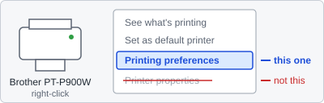
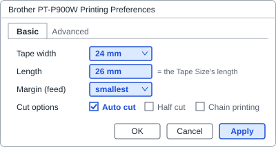

# Brother PT-P900W: how to set the printer

The tape printer takes its tape from its own **Printing preferences** in Windows, not from the app. Set them once on each PC, and again whenever a different tape is loaded.

## 1. Open Printing preferences

1. Open **Control Panel → Devices and Printers** (or Windows **Settings → Bluetooth & devices → Printers & scanners**).
2. **Right-click** Brother PT-P900W and choose **Printing preferences**. Not **Printer properties**: that does not set the tape.

## 2. Set the tape on the Basic tab

1. **Tape width**: the tape loaded: **24 mm**.
2. **Length**: the length of the app's Tape Size: **26 mm** for Topup Labels ("24 mm tape × 26 mm").
3. **Margin** (feed): the smallest.
4. **Cut options**: Auto cut on; Half cut and Chain printing as your team prefers.
5. **Apply**, then **OK**.

If the app still says the old tape: right-click the printer → **Printer properties** → **Advanced** tab → **Printing Defaults…**, set the same there, then **Apply** (this may need an administrator).

## 3. Set the app (Settings tab)

1. **Printer**: Brother PT-P900W. **Printer resolution**: **360 dpi**.
2. **Label in this printer**: the Tape Size set above, e.g. "24 mm tape × 26 mm".
3. **Test print**. The test label shows its outline and the printable band edges. If it is not on the tape, change the **X / Y offsets**, test again, then **Save**.

## What the app's messages mean

- **"The printer is set to 36 mm tape; set 24 mm in its Printing preferences."** Not printed: the tape width is wrong. Do step 2.
- **"The printer is set to 100 mm long labels; set 26 mm in its Printing preferences…"** Printed, but the labels may be the wrong length. Set the Length in step 2.
- **"Could not check the tape width; check the printer is set to 24 mm tape."** Printed, but the app could not read the printer's setting. Check step 2 yourself.

In the app, **How to set the printer** (on the Settings tab and next to these messages) opens this page.
