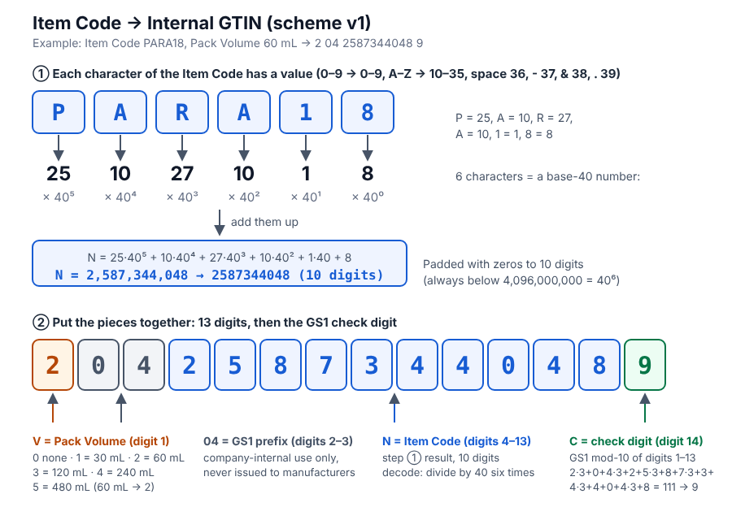

# How an Item Code becomes an Internal GTIN

A label carries a 14-digit **Internal GTIN** made from the **Item Code** and the **Pack Volume**. BCS turns it back into the Item Code with arithmetic alone: no table to keep in sync. The rules are fixed in [ADR 0002](adr/0002-internal-gtin-scheme-v1.md); the code is `src/core/internalGtin.ts`.



([SVG version](gtin-encoding.svg))

## The 14 digits

```
 V | 0 4 | N N N N N N N N N N | C
 │    │    │                     └─ check digit: GS1 mod-10 of the first 13 digits
 │    │    └─ the Item Code as a base-40 number, zero-padded to 10 digits
 │    └─ GS1 prefix 04: restricted circulation inside one company
 └─ Pack Volume digit: 0 none · 1 30 mL · 2 60 mL · 3 120 mL · 4 240 mL · 5 480 mL
```

## Steps (example: `PARA18`, 60 mL)

1. **Value of each character:** `0`–`9` → 0–9, `A`–`Z` → 10–35, space → 36, `-` → 37, `&` → 38, `.` → 39. `PARA18` → 25, 10, 27, 10, 1, 8.
2. **Base 40:** N = 25·40⁵ + 10·40⁴ + 27·40³ + 10·40² + 1·40 + 8 = **2,587,344,048**, written with 10 digits (`2587344048`).
3. **Pack Volume digit:** 60 mL → `2`. Put it first, then `04`, then N: `2 04 2587344048`.
4. **Check digit:** weight the 13 digits 3, 1, 3, 1… from the right, add them (= 111), and take what is needed to reach the next multiple of 10 → **9**.
5. **Result:** `20425873440489`.

On the label this is AI (01), followed by AI (17) the Expiry and AI (10) the Lot: `(01)20425873440489(17)271231(10)2512172-1`.

## Going back

Check the 14 digits and the check digit, check digits 2–3 are `04`, take N (digits 4–13) and divide by 40 six times: the remainders, last first, are the six characters.

## More examples

| Item Code | Pack Volume | Internal GTIN |
|---|---|---|
| `PARA01` | none | `00425873440010` |
| `PARA18` | none | `00425873440485` |
| `PARA18` | 60 mL | `20425873440489` |
| `AIR 01` | none | `00410718656015` |

## Good to know

- An Item Code is exactly 6 characters from the 40 above (lower case is upper-cased).
- Digits 6–8 as the Pack Volume digit and N from 4,096,000,000 (40⁶) up are reserved for a future version; `9` is never used (GS1 variable measure).
- Once labels are printed this scheme cannot change.
